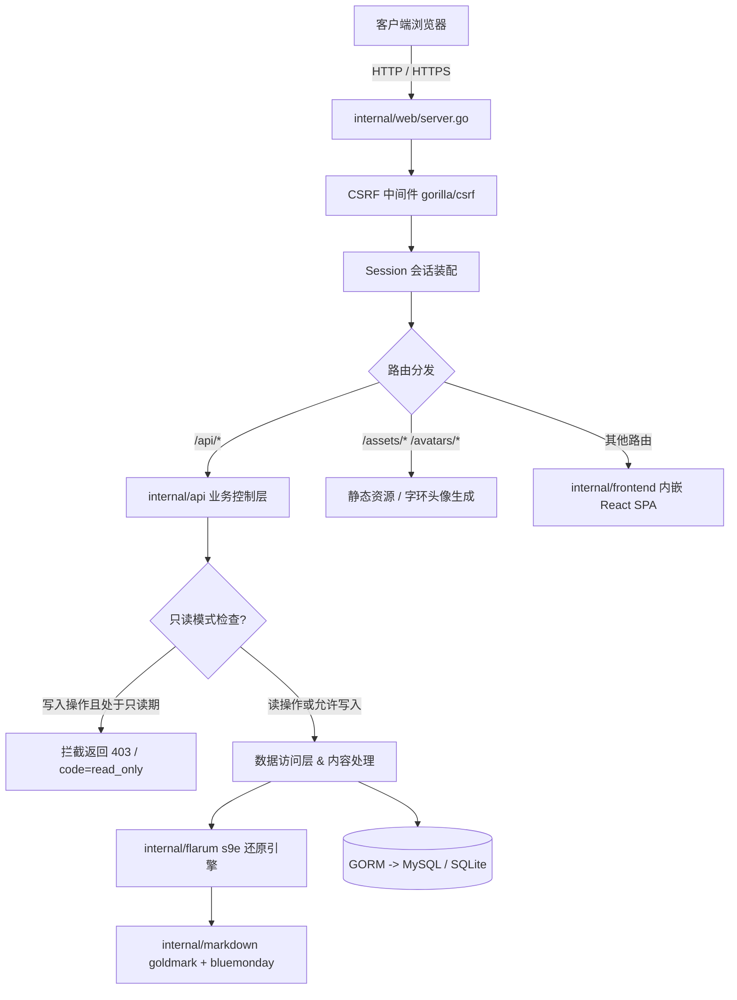
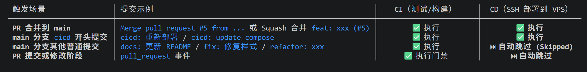
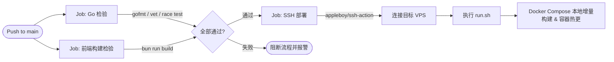
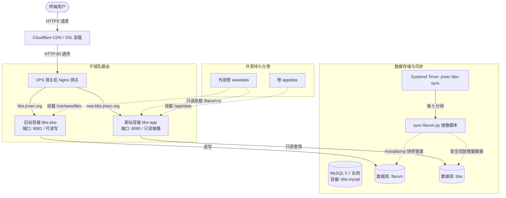

# JNSEC BBS 

原有 PHP Flarum 论坛系统进行重构。项目基于 **Go 1.25** 与 **React 19** 构建，采用前后端单二进制嵌入交付，在完全兼容 Flarum 历史数据（9,000+ 讨论与帖子、s9e 富文本、bcrypt 密码、旧版 URL）的前提下，实现轻量化与自动化运维。

### 后端服务 (Backend)
- **核心语言与框架**：Go 1.25+、Gin 
- **数据持久化**：GORM ，生产环境运行于 MySQL 5.7
- **内容解析与安全**：
  - `goldmark`：CommonMark 标准 Markdown 解析器
  - `bluemonday`：HTML 白名单净化过滤（抵御 XSS 注入）
  - `internal/flarum`：实现 Flarum s9e XML 逆向还原引擎（还原历史发帖原文且保持 SHA-256 强一致）提取数据
- **打包集成**：标准库 `embed.FS`，前端构建产物直接内嵌于单一 Go 二进制可执行文件。

### 前端系统 (Frontend)
- **开发与构建**：React 19、TypeScript、Vite 6、Node 
- **样式与组件**：Tailwind CSS v4、Radix UI Primitives、Lucide React 图标库、Geist Variable 字体
- **状态与缓存**：TanStack React Query v5（服务端状态与缓存）、NanoStores（轻量原子前端状态）

### 运维与基础设施 (Infra & DevOps)
- **容器与网关**：Docker、Docker Compose、Nginx（宿主机反代与子域名分流）
- **CDN 与证书**：Cloudflare CDN（边缘 HTTPS 卸载与安全防护）
- **定时同步**：Python 3 同步脚本 (`scripts/sync-flarum.py`) + Linux Systemd Timer

---

## 2. 项目架构 (Project Architecture)

```
jnsecBBS/
├── cmd/bbs/               # 命令行总入口 (serve, init-db, seed-admin, audit-content)
├── internal/
│   ├── api/               # RESTful API 路由分发、业务控制器与只读拦截器
│   ├── auth/              # 鉴权引擎 (RBAC 角色组、Session 会话、密码校验)
│   ├── config/            # 配置映射 (支持 config.yaml 与 JNSEC_* 环境变量覆盖)
│   ├── db/                # 数据库连接、GORM 迁移与只读检查
│   ├── flarum/            # Flarum s9e XML 格式还原引擎 (与旧版 PHP 行为完全等价)
│   ├── frontend/          # embed.FS 静态产物内嵌入口 (dist/*)
│   ├── markdown/          # Markdown 渲染与 XSS 净化管道
│   ├── models/            # 数据模型定义 (兼容原 Flarum 表结构及扩展表)
│   ├── web/               # Web 服务装配 (Gin 引擎、CSRF 中间件、SPA Fallback、头像生成)
├── frontend/              # React 19 SPA 前端工程 (源码、组件、状态与页面)
├── deploy/                # 部署配置 (Nginx 配置模板、Systemd 单元、SQL 迁移脚本)
├── scripts/               # 核心同步工具 (sync-flarum.py 及其实际环境自动化测试)
├── Dockerfile             # 多阶段构建文件 (Bun 构建前端 -> Go 编译静态二进制 -> Alpine 运行)
└── docker-compose.yaml    # 生产容器编排文件
```

### 核心处理链路


---

## 3. CI/CD 架构 (CI/CD Architecture)

代码仓库使用 **GitHub Actions** 自动化驱动持续集成与持续部署（CI/CD）：




### 部署关键细节
1. **测试门禁**：
   - 后端执行 `gofmt` 格式断言、`go vet` 静态排查以及 `go test -race` 竞态安全测试。
   - 前端通过 `bun --frozen-lockfile` 安装并执行 `tsc -b && vite build`，确保无类型及语法缺陷。
2. **安全连接**：
   - 依赖 GitHub Secrets：`VPS_HOST`、`VPS_USER`、`VPS_SSH_KEY`、`VPS_FINGERPRINT`。
3. **CD 触发策略**：
   - 为避免非生产变更频繁触发构建，CD（`deploy` Job）仅在以下两种场景执行：
     - **PR 合并到 main**：合并提交（包含 `Merge pull request`、`Merge branch` 或 PR 编号）。
     - **以 `cicd` 开头的提交**：例如 `cicd: 重新部署`、`cicd: force rebuild`。
   - 其他常规提交（如 `docs:`, `fix:`, `refactor:` 等）仅执行 CI 检查，自动跳过 CD 部署。
4. **VPS 落地触发**：
   - 经 SSH 连接后进入 `/opt/backup/refactorBBS/jnsecBBS`，触发 `run.sh` 执行 `git pull --ff-only`、配置自动同步、镜像构建与 `docker-compose up -d --no-deps app` 容器平滑切换。

---

## 4. 部署后架构与运行时拓扑 (Deployed Architecture)

当前线上采用**“子域名分流、旧站可写、新站只读、周期增量镜像”**的高可用灰度过渡架构：



### 运行特征说明
1. **流量与分流**：
   - `bbs.jnsec.org`：指向原 PHP Flarum 容器（端口 8081），作为目前唯一允许写入的生产源站。
   - `new.bbs.jnsec.org`：指向新 Go 论坛容器（端口 8080），以 `JNSEC_READ_ONLY=true` 启动，面向公网提供只读体验用于测试。
2. **数据同步保证**：
   - `jnsec-bbs-sync.timer` 每 5 分钟拉起 `sync-flarum.py`，直接在 `bbs-mysql` 容器内完成 `flarum` → `bbs` 库的一致性快照同步。
   - 脚本采用黑名单/白名单保留机制，跨同步保留 `flarum_access_tokens`，保证用户在新站登录会话不掉线。
3. **资源无缝共享**：
   - 共享 Docker 卷 `wwwdata`：PHP 容器挂载写入，Go 容器只读挂载至 `/flarum:ro`，旧头像与附件直接由 Go 容器的 `/assets` 路由透出，免除额外磁盘同步开销。

---

## 5. 快速开始与常用操作

### 本地开发
```bash
cd frontend
bun install --frozen-lockfile
bun run build
cd ..

go build -o bbs ./cmd/bbs
export JNSEC_SESSION_SECRET="$(openssl rand -hex 32)"
./bbs init-db -c config-test.yaml  # 仅适用于空数据库
./bbs serve -c config-test.yaml
```

应用启动仅校验数据库，不自动建表。已有兼容库由管理员显式执行
`./bbs migrate-db -c config-test.yaml`，升级 Go 辅助表与迁移版本记录；不要对旧站源库
运行该命令。只读镜像同步会保留 `bbs_user_profiles`、`bbs_schema_migrations` 等已批准
本地表，继续拒绝未知表及结构漂移。

`bbs native-import` 可将旧站快照转换到隔离的 `bbs_v2` 影子库，保留原始数据归档。
在线 API 尚未适配该结构，不可直接修改应用 DSN。详见
[独立数据库迁移](docs/native-migration.md) 和 [当前进度](PLAN.md)。

本轮修复回复原位编辑、分类返回列表及分页跳转（#5–#7），保持现有三栏样式。
验收使用本机合成数据，覆盖普通成员、取消/失败重试、首页/末页/指定页和移动分类。
部署文件与目录沿用目标分支现状：`run.sh`、`Dockerfile`、`docker-compose.yaml`、
`config.example.yaml`、`deploy/`、`.github/` 不在本 PR 的修改范围。

### 生产同步任务维护
```bash
# 查看同步定时器状态
sudo systemctl status jnsec-bbs-sync.timer
# 查看最近 20 条同步执行日志
sudo journalctl -u jnsec-bbs-sync.service -n 20 --no-pager
# 手动立即触发一次增量同步
sudo systemctl start jnsec-bbs-sync.service
```

## 6、测试 issue 

浏览新站测试得到问题的同学在 issue 发一下具体问题以及简单的复现步骤，也许是这样说，别在 QQ 群说了，人多了问题多了不太好记。
